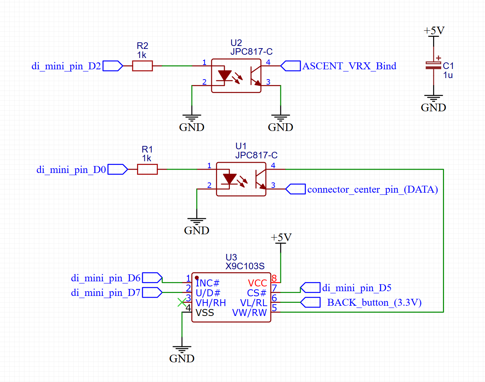

# Walksnail (Ascent) VRX Hardware Control Node (Wemos D1 Mini)

Цей репозиторій містить прошивку для модуля **Wemos D1 Mini (ESP8266)**, який виступає в ролі інтелектуального залізничного вузла керування для відеоприймача **Ascent / Walksnail Avatar VRX**. 

Пристрій автоматично комутує аналогову клавіатуру VRX за допомогою цифрового потенціометра (X9C103S) та оптопари (PC817), приймаючи команди від наземного пульта або через вбудований Web-інтерфейс.

## 🚀 Основні можливості

* **Dual-Mode Control:** Паралельна робота від фізичного пульта по UART та через Wi-Fi Web-панель.
* **Smart Wi-Fi (RF Noise Protection):** Модуль автоматично тушить свій Wi-Fi через 10 секунд після старту, якщо виявляє стабільний потік пакетів (Heartbeat) від пульта. Це повністю виключає радіозавади в ефірі під час польотів.
* **Captive Portal (DNSServer):** Автоматичний перехід на сторінку керування при підключенні до Wi-Fi мережі (не потрібно вводити IP вручную).
* **Live UART Monitor:** Відображення сирого HEX-потоку, що прилітає від пульта, прямо в Web-інтерфейсі для швидкого налагодження.
* **Енергонезалежна пам'ять (EEPROM):** Динамічна таблиця конфігурації 9-позиційної матриці кнопок (Кроки опору 0-99 та HEX-коди) з можливістю редагування через браузер.
* **Залізобетонні таймінги:** Точна імітація натискання за допомогою апаратного розриву лінії оптопарою PC817, що унеможливлює "брязкання" під час зміни опору.

---

## 🛠 Апаратна схема з'єднання (Pinout)

| Компонент | Пін Wemos D1 Mini | Опис |
| :--- | :--- | :--- |
| **X9C103S (CS)** | `D5 (GPIO14)` | Chip Select цифрового потенціометра. |
| **X9C103S (INC)** | `D6 (GPIO12)` | Increment (крок) цифрового потенціометра. |
| **X9C103S (U/D)** | `D7 (GPIO13)` | Up/Down (напрямок) цифрового потенціометра. |
| **PC817 (Тригер кнопок)** | `D0 (GPIO16)` | Комутує лінію `VL` потенціометра на лінію `DATA` приймача (імітація натискання). |
| **PC817 (Ключ BIND)** | `D2 (GPIO4)` | Пряме замикання лінії бінду Walksnail на масу (фіксований імпульс 500 мс). |
| **Software UART RX** | `D3 (GPIO0)` | Вхід для підключення лінії `TX` від пульта керування (наприклад, ESP32-C3). |
| **Software UART TX** | `D4 (GPIO2)` | Вихід програмного UART (зарезервовано). |



> ⚠️ **Важливо:** Рідний апаратний порт `Hardware Serial (TX/RX)` залишається абсолютно вільним! Ви можете підключати плату до комп'ютера по USB для моніторингу логів на швидкості `115200` навіть під час роботи всієї системи.

---

## 📐 Специфікація Матриці Кнопок (Default Config)

Система з коробки ініціалізується наступною конфігурацією байтів (пакети пульта) та кроків X9C103S:

| Індекс | Назва кнопки | Крок (0-99) | HEX-пакет від пульта (3 байти) |
| :---: | :--- | :---: | :--- |
| **0** | `UP` | 5 | `46 FF 29` |
| **1** | `DOWN` | 48 | `C6 FB 27` |
| **2** | `LEFT` | 10 | `46 FB 25` |
| **3** | `RIGHT` | 21 | `B7 23 23`[cite: 2] |
| **4** | `ENTER (OK)` | 32 | `0C FF 2B`[cite: 2] |
| **5** | `BACK` | 90 | `C6 DD 3F`[cite: 2] |
| **6** | `REC` | 99 | `46 DD 3D`[cite: 2] |
| **7** | `BIND` | *Цифровий пін*[cite: 2] | `AC FF 53`[cite: 2] |
| **8** | `FUNC` | *Зарезервовано*[cite: 2] | `4C FF 3B`[cite: 2] |
| **-** | `IDLE (Пульс)`[cite: 2]| *Ігнорується*[cite: 2] | `C6 FF 67`[cite: 2] |

---

## 💻 Інтерфейс Web-Панелі Калібрування[cite: 2]

Коли пульт вимкнений, плата піднімає власну точку доступу[cite: 2].

1. Підключіться до Wi-Fi мережі: `Walksnail_Remote` (пароль: `12345678`)[cite: 2].
2. Браузер вашого смартфона автоматично відкриє сторінку керування. Якщо цього не сталося, перейдіть за адресою `http://192.168.4.1/`[cite: 2].

### Доступні функції в UI:[cite: 2]
* **OSD Joystick:** Віртуальний пульт для кліків по меню прямо з екрана[cite: 2].
* **Live UART Receiver:** Показує статус сигналу з пульта. Відображає `(OK)` при натисканні або `(IDLE)` при фіксації холостого ходу[cite: 2].
* **Matrix Editor & Timings:** Інтерактивна таблиця, де можна змінити будь-який байт чи крок опору, а також налаштувати тривалість утримання (Hold Time T2), після чого натиснути **SAVE ALL CONFIG** для запису в EEPROM.

---

## 🧠 Логіка роботи Пакетного Комутатора[cite: 2]

Для запобігання хибних спрацювань під час зміни опору, комутація відбувається за чітким алгоритмом:
1. **Фаза 1 (Встановлення опору):** Мікроконтролер встановлює повзунок X9C103S у потрібну позицію. Лінія до VRX розірвана оптопарою PC817, тому VRX не бачить "стрибків" опору.
2. **Фаза 2 (Клік / T2):** Вмикається цифровий тригер `PIN_TRIGER` (PC817) і замикає стабільний опір на VRX на заданий в UI час (за замовчуванням 50 мс).
3. **Фаза 3 (Відпускання):** Тригер розмикається, розриваючи лінію (імітація відпускання кнопки).

## 🛠 Залежності[cite: 2]
Для компіляції проекту в середовищі Arduino IDE / PlatformIO необхідні наступні бібліотеки:[cite: 2]
* `ESP8266WiFi` (Вбудована)[cite: 2]
* `ESP8266WebServer` (Вбудована)[cite: 2]
* `DNSServer` (Вбудована)[cite: 2]
* `EEPROM` (Вбудована)[cite: 2]
* `SoftwareSerial` (Вбудована в ядро ESP8266)[cite: 2]

## 🔌 Схема підключення (Wiring Diagram)[cite: 2]

Зв'язок між керуючим модулем та виконавчим вузлом (Wemos D1 Mini) реалізовано через ізольовані програмні порти UART[cite: 2]. Оскільки обидва мікроконтролери працюють з логічними рівнями 3.3V, додаткові дільники напруги не потрібні[cite: 2].

```text
[ ESP32-C3 Пульт ]                             [ Wemos D1 Mini (VRX Node) ]
+------------------+                           +----------------------------+
|                  |                           |                            |
|        GPIO 4 TX |-------------------------->| D3 (GPIO0) RX (SoftSerial) |
|        GPIO 3 RX |<--------------------------| D4 (GPIO2) TX (SoftSerial) |
|              GND |<------------------------->| GND (Спільна земля)        |
+------------------+                           +----------------------------+
                                                            |
+-----------------------------------------------------------+
|
v
[ Блок комутації X9C103S + PC817 ]   [ Walksnail / Ascent VRX ]
+--------------------------------+   +------------------+
| D5/D6/D7 -> X9C103S Control    |   |                  |
| X9C103S (VW) --------------------->| Лінія DATA       |
| D0 -> PC817 Trig на лінії (VL) |   |                  |
| D2 -> PC817 Bind --------------|-->| Лінія BIND       |
+--------------------------------+   +------------------+

